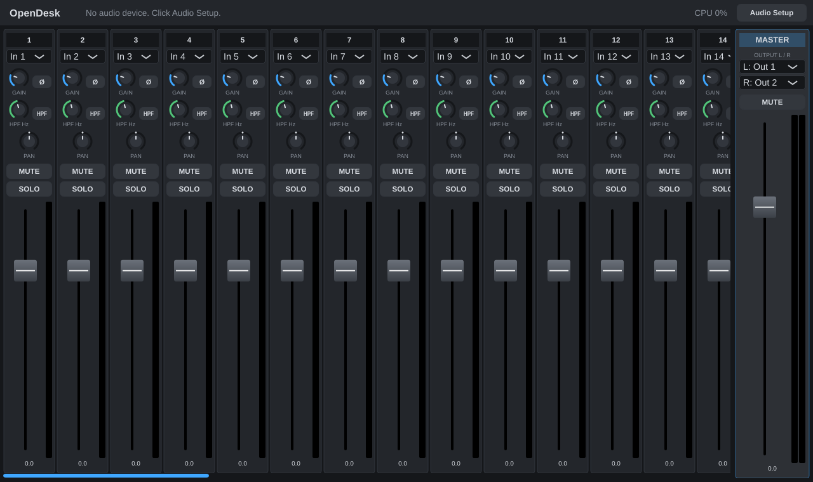

# OpenDesk

A personal Mac mixing app that works like a large-format live console's offline editor, but passes real audio from your interface. Inspired by the DiGiCo Quantum 225 workflow; all code and graphics are original.



## What works now (v0.1)

- 48 input channels, each with input patch, gain, polarity, high-pass filter, pan, mute, solo, meter and fader
- Stereo master with output patch, mute, L/R meters and fader
- Any Core Audio interface (Audio Setup button), remembered between launches
- Engine tests that prove audio passes through and the controls behave

Planned next: EQ and dynamics, aux and group buses, matrix, snapshots, sessions, multitrack record and playback. See the v1 spec.

## Getting the app

Every push builds the Mac app on GitHub:

1. Open the **Actions** tab, pick the latest green **Build Mac app** run.
2. Download **OpenDesk-mac** under Artifacts and unzip it twice to get `OpenDesk.app`.
3. The app isn't signed with an Apple developer ID, so the first time: right-click `OpenDesk.app` > **Open** > **Open**. If macOS still refuses, run `xattr -cr /path/to/OpenDesk.app` in Terminal.
4. Allow microphone access when asked; that's how macOS lets apps read audio interface inputs.
5. Click **Audio Setup**, pick your interface for input and output, and enable the inputs you want.

Channel N listens to interface input N by default. The master goes to outputs 1 and 2.

## Building it yourself

Needs Xcode command line tools and CMake 3.22+.

```sh
cmake -S . -B build -G Xcode
cmake --build build --config Release
ctest --test-dir build -C Release
open build/OpenDesk_artefacts/Release/OpenDesk.app
```

JUCE 8.0.9 is downloaded automatically on first configure. JUCE is used under its GPLv3 / commercial licence terms; this is a personal, non-distributed project.
